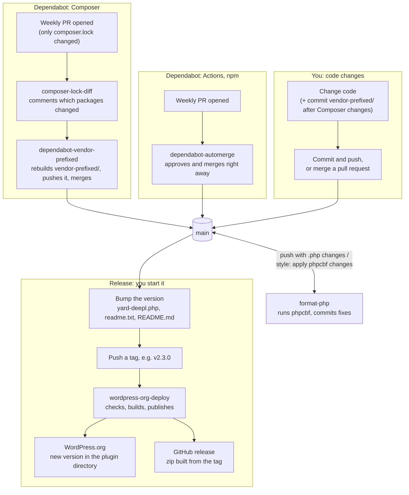

# Releasing

How changes reach `main`, and how a tag on `main` becomes a release on WordPress.org and GitHub. All workflows live in [`.github/workflows`](../.github/workflows).

## The whole picture



Anything can land on `main` at any time. Nothing is published until you push a tag.

## Release routine

1. Make sure `main` has everything you want in the release.
2. Set the new version in:
   - `yard-deepl.php`: `Version:`
   - `readme.txt`: `Stable tag:`, plus a changelog entry
   - `README.md`: `Stable tag:`, plus a changelog entry
3. Commit (for example `release: v2.3.0`) and push.
4. Optional: run **Deploy to WordPress.org** manually under the Actions tab. Dry run is on by default, so it runs every check and build without publishing.
5. Push the tag:

   ```sh
   git tag v2.3.0
   git push origin v2.3.0
   ```

6. Follow the run under the Actions tab. When it is green, the version is live on WordPress.org and GitHub.

## The workflows

| Workflow | Runs when | What it does |
| --- | --- | --- |
| `composer-lock-diff.yml` | A PR changes `composer.lock` | Comments on the PR which packages changed, from which version to which. |
| `dependabot-vendor-prefixed.yml` | Dependabot opens a Composer PR (`dependabot/composer/...`) | Rebuilds `vendor-prefixed/` from the new `composer.lock`, drops date-only changes, pushes the result to the PR and merges it. |
| `dependabot-automerge.yml` | Dependabot opens any other PR (Actions, npm) | Approves and merges the PR right away. Composer PRs are skipped; `dependabot-vendor-prefixed.yml` merges those after the rebuild. |
| `format-php.yml` | A push to `main` changes a `.php` file or `phpcs.xml` | Runs `phpcbf` and commits the fixes as `style: apply phpcbf changes`. |
| `wordpress-org-deploy.yml` | A tag is pushed, or a manual run | Checks, builds and publishes the release. See below. |

### Inside wordpress-org-deploy

The steps run in order. If a check fails, the run stops and nothing is published.

1. **Check out the tag.** The code exactly as it was when tagged, even if `main` has moved on.
2. **Check the version numbers.** The version in `yard-deepl.php`, the stable tag in `readme.txt` and `README.md`, and the tag name must all be the same. *Stops if they differ.*
3. **Check `vendor-prefixed/`.** Rebuilds it from `composer.lock` and compares it with the committed copy, ignoring the Strauss date lines. Then puts the committed copy back, so the release ships exactly what is in git. *Stops if out of date.*
4. **Build assets.** `npm ci` and `npm run build` produce `dist/`.
5. **Upload to WordPress.org.** The 10up action copies the plugin to SVN, without the files in `.distignore`. *Skipped in a dry run.*
6. **Build the zip** from the same checked-out files, without the files in `.distignore`. Because it uses the tag, a rerun always gives the zip for that version.
7. **Create the GitHub release** for the tag and attach the zip. *Skipped in a dry run.*

## vendor-prefixed/

The plugin loads its Composer dependencies (PHP-DI and its packages) from `vendor-prefixed/`, never from `vendor/`. [Strauss](https://github.com/BrianHenryIE/strauss) builds it from `composer.lock` during `composer install`, and it is committed to git.

- After changing Composer packages yourself, run `composer install` and commit `vendor-prefixed/` together with `composer.lock`.
- Strauss writes the build date into every file (`Modified by ... on <date>`), so every `composer install` touches all files. Undo only the files where the date is the only change, so real dependency changes stay:

  ```sh
  git diff --name-only -- vendor-prefixed | while read -r file; do
    git diff -I 'Modified by .* using' --quiet -- "$file" && git checkout -- "$file"
  done
  ```

  Don't use `git restore vendor-prefixed`: that also throws away the real changes from a dependency update.
- The deploy checks that the committed `vendor-prefixed/` matches `composer.lock` and stops if it doesn't.

## When something stops

| What happened | Where | How to fix it |
| --- | --- | --- |
| Version numbers differ | `wordpress-org-deploy`, step 2 | Make the version the same in the three files and the tag. Delete the wrong tag, commit the fix and tag again. |
| `vendor-prefixed/` is out of date | `wordpress-org-deploy`, step 3 | Run `composer install` locally, commit `vendor-prefixed/`, then tag again. |
| A Dependabot Composer PR stays open | `dependabot-vendor-prefixed` | The rebuild or merge failed. Open the failed run to see why. Comment `@dependabot recreate` on the PR to start over. |
| A `style: apply phpcbf changes` commit appears | `format-php` | Nothing to fix. Pull before you continue working, so you have the formatted code. |

To delete a wrong tag before tagging again:

```sh
git tag -d v2.3.0
git push origin :refs/tags/v2.3.0
```

Only do this when the run stopped before step 5. Once a version is on WordPress.org, release a new version instead of reusing the tag.
